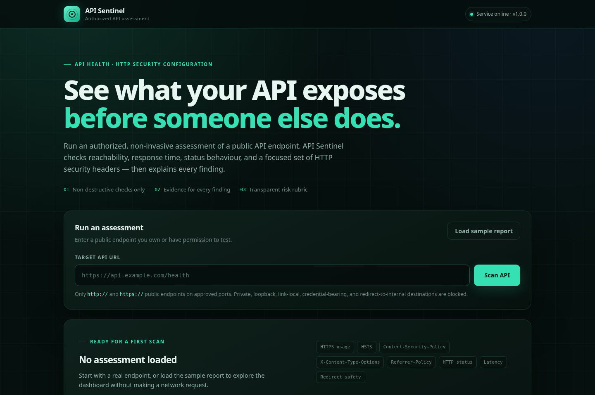
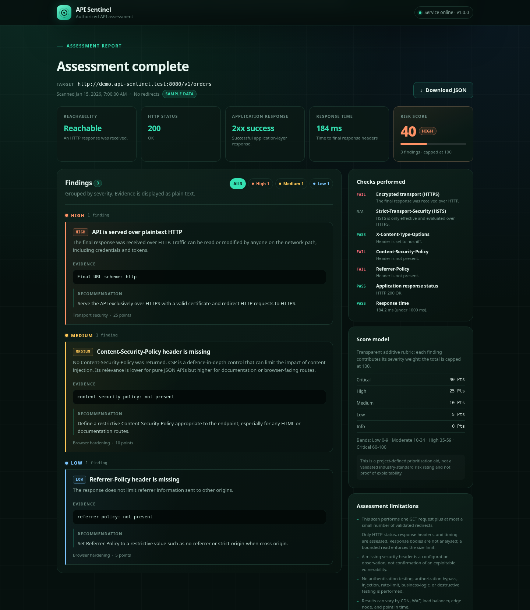
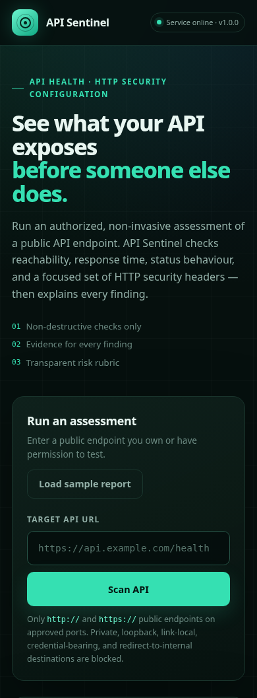

# API Sentinel

**A local, authorized API health and HTTP security-configuration scanner with a dark, accessible dashboard.**

API Sentinel performs a bounded, non-destructive `GET` request against a public HTTP(S)
endpoint, records availability and latency, inspects a focused set of security-related
response headers, and explains every finding with evidence and remediation advice. Results
are returned as a structured JSON report and rendered in a browser dashboard.

> **Authorized use only.** Scan only APIs that you own or have explicit permission to test.
> API Sentinel does not exploit, fuzz, authenticate, enumerate, or attack targets.



---

## Abstract

Small teams often deploy APIs without checking basic HTTP security configuration. Missing
transport encryption, HSTS, content-type protections, CSP, or referrer policy can remain
unnoticed because the API still "works". API Sentinel makes those observations visible in
one scan: it verifies whether an endpoint responds, separates reachability from application
success, records response time, evaluates a small explicit header ruleset, and produces a
transparent risk score.

The project is deliberately a **local MVP**. It is built to be easy to run and review, not
to be a production multi-tenant scanning service.

## Problem

An API can return `200 OK` while still being served over plaintext HTTP or missing basic
browser-hardening headers. Manually checking response headers is repetitive, and many
available scanners are heavyweight, require accounts, or report opaque scores. There is a
need for a small, inspectable tool that:

- distinguishes a reachable host from a successful application response;
- detects obvious transport and header configuration gaps;
- shows the evidence and a practical recommendation for every finding;
- explains exactly how its score was calculated;
- does not become an SSRF pivot into private or internal networks.

## Objectives

1. Check reachability, HTTP status, latency, and a defined set of security headers.
2. Produce a consistent JSON report and a usable browser dashboard.
3. Keep the scoring rule explicit, additive, and reproducible.
4. Treat outbound-request safety (SSRF, DNS rebinding, redirects, resource limits) as a
   first-class requirement.
5. Provide deterministic tests that do not depend on public internet availability.
6. Document the architecture, security model, limitations, and demo procedure.

## Features

- **API health checks:** reachability, HTTP status and reason, application success, latency.
- **Header assessment:** HTTPS, HSTS, `X-Content-Type-Options`, CSP, `Referrer-Policy`.
- **Explainable findings:** severity, category, evidence, impact, remediation, point weight.
- **Transparent score:** additive weights capped at 100, with a published band table.
- **Redirect visibility:** manual redirect following with every hop re-validated; the chain
  is included in the report.
- **SSRF hardening:** scheme/credential/port allow-lists, DNS checks, connect-time address
  validation, and IP-pinned connections to close the DNS-rebinding window.
- **Resource limits:** total scan timeout, DNS timeout, redirect cap, and bounded body read.
- **Dashboard:** dark responsive UI, loading/error states, severity filters, sample report,
  JSON download, keyboard support, live-region announcements, and safe DOM rendering.
- **No database and no paid APIs:** one Python process plus static HTML/CSS/JS.

## Screenshots

| Dashboard | Sample report |
| --- | --- |
|  |  |

Mobile layout:



The report screenshot uses the deterministic sample report from `GET /api/demo`; no
outbound request is made when loading it.

---

## Architecture

A full component diagram, scan sequence, and threat-model discussion are in
[`docs/architecture.md`](docs/architecture.md).

```text
Browser dashboard
      │  POST /api/scan
      ▼
FastAPI endpoint ──► SafeFetcher ──► Guarded httpcore backend ──► target API
      │                  │                    │
      │                  │                    └─ re-resolve, validate all answers,
      │                  │                       connect to the validated IP literal
      │                  └─ manual redirects, every Location re-validated
      ▼
Rule engine ──► additive risk score ──► Pydantic ScanReport ──► dashboard / JSON download
```

### Request flow

1. The URL is parsed and checked for scheme, credentials, hostname syntax, port, and length.
2. DNS is resolved. **Every** returned address must pass the public-address policy; a
   hostname with any disallowed answer is rejected.
3. The guarded transport resolves and validates again at TCP-connect time, then connects to
   the validated IP literal. TLS SNI and certificate verification still use the hostname.
4. Redirects are **not** followed automatically. Each `Location` is resolved and passes the
   complete URL/DNS/address policy again; at most three hops are followed.
5. The response status, headers, timing, and a bounded body read are passed to the rule
   engine. The report is returned as JSON.
6. Invalid or prohibited destinations return HTTP `422`. An unreachable but syntactically
   valid target returns HTTP `200` with `reachable: false` and a structured error, because
   the target passed validation and the scan itself completed.

### Project structure

```text
api-sentinel/
├── main.py                 # FastAPI app, endpoints, middleware, static files
├── app/
│   ├── config.py           # Environment settings and hard limits
│   ├── demo.py             # Deterministic sample report
│   ├── errors.py           # Explicit, safe error types
│   ├── models.py           # Pydantic request/response models
│   ├── network.py          # Guarded transport, bounded fetch, redirects
│   ├── scanner.py          # Rules, scoring, report construction
│   └── url_safety.py       # URL, DNS, and IP address policy
├── demo_target.py          # Intentionally under-configured local demo API
├── static/
│   ├── index.html          # Dashboard structure and templates
│   ├── styles.css          # Dark responsive theme
│   └── app.js              # Fetching, rendering, filters, JSON download
├── tests/                  # Deterministic pytest suite
├── docs/architecture.md    # Architecture and security design
├── screenshots/            # Dashboard captures
├── scripts/run_demo.sh     # Starts app + demo target with cleanup
├── requirements.txt        # Pinned runtime/test dependencies
├── pytest.ini
├── LICENSE
└── README.md
```

## Tech stack

| Layer | Choice |
| --- | --- |
| Language | Python 3.11+ (tested on Python 3.13.14) |
| Web framework | FastAPI |
| ASGI server | Uvicorn (plain, no optional extras) |
| HTTP client | HTTPX with HTTP/1.1 and a custom httpcore network backend |
| Validation/models | Pydantic v2 |
| Dashboard | HTML, CSS, vanilla JavaScript |
| Tests | pytest, Starlette TestClient, HTTPX MockTransport, local HTTP servers |
| Version control | Git |

No database, frontend framework, cloud service, or paid API is used.

---

## Installation

From the project directory:

```bash
python3 -m venv .venv
.venv/bin/python -m pip install --upgrade pip
.venv/bin/pip install -r requirements.txt
```

The virtual environment is project-local; no system packages or `sudo` are required.

## Running

### Start the application

```bash
.venv/bin/uvicorn main:app --host 127.0.0.1 --port 8000
```

Open <http://127.0.0.1:8000>. The interactive API schema is at
<http://127.0.0.1:8000/api/docs>.

The application intentionally binds to loopback. Do not change the bind address without
adding authentication and network egress controls; see [Security model](#security-model).

### Full local demonstration

Loopback scanning is **disabled by default**. For a local demo, start the scanner with the
explicit opt-in flag:

**Terminal 1 — scanner with loopback demo mode**

```bash
API_SENTINEL_ALLOW_LOOPBACK=1 .venv/bin/uvicorn main:app --host 127.0.0.1 --port 8000
```

**Terminal 2 — intentionally under-configured demo API**

```bash
.venv/bin/uvicorn demo_target:app --host 127.0.0.1 --port 8001
```

Then open <http://127.0.0.1:8000> and scan:

```text
http://127.0.0.1:8001/api/orders
```

Useful demo routes:

| URL | Expected result |
| --- | --- |
| `http://127.0.0.1:8001/api/orders` | Reachable, HTTP 200, missing CSP/referrer, plaintext HTTP finding |
| `http://127.0.0.1:8001/api/secure` | Header checks pass over HTTP except transport encryption |
| `http://127.0.0.1:8001/api/error` | Reachable with HTTP 500 and `application_ok: false` |
| `http://127.0.0.1:8001/redirect` | Follows one redirect and reports the chain |

Alternatively, run both servers with cleanup on exit:

```bash
./scripts/run_demo.sh
```

`API_SENTINEL_ALLOW_LOOPBACK=1` permits **only loopback** in addition to public addresses;
private, link-local, and other non-public ranges remain blocked. Never expose this mode to
untrusted users.

Try the dashboard without any target by clicking **Load sample report**. It calls
`GET /api/demo`, which returns a fixed local report and performs no network request.

---

## API reference

All request/response bodies are JSON. Interactive documentation is available at
`/api/docs`.

### `GET /`

Serves the dashboard.

### `GET /api/health`

Returns service metadata and the current loopback policy.

```json
{
  "status": "ok",
  "service": "API Sentinel",
  "version": "1.0.0",
  "utc_time": "2026-10-25T19:12:14Z",
  "ssrf_protection": "enabled",
  "loopback_scanning": "enabled (local demo only)"
}
```

`loopback_scanning` is `"disabled"` in the default configuration.

### `GET /api/demo`

Returns a deterministic sample `ScanReport` with `demo: true`. No outbound request is made.

### `POST /api/scan`

Request:

```json
{
  "url": "https://api.example.com/health"
}
```

- `url` must be a complete `http://` or `https://` URL, 1–2048 characters.
- The target must be a permitted public destination on an allowed port.
- The endpoint performs one `GET` plus at most three validated redirects.

Success returns a `ScanReport` with HTTP `200`, including both reachable and unreachable
targets once the URL has passed validation.

### Error responses

Invalid or prohibited **input** returns HTTP `422`:

```json
{
  "detail": "URLs containing embedded usernames or passwords are not permitted.",
  "code": "credentials_not_allowed"
}
```

Representative codes:

| Code | Meaning |
| --- | --- |
| `invalid_url`, `invalid_scheme`, `invalid_host`, `invalid_port` | Malformed or unsupported URL components |
| `credentials_not_allowed` | Embedded `user:pass@` credentials |
| `local_hostname` | Local/internal hostname suffix |
| `port_not_allowed` | Port outside the configured allow-list |
| `dns_failure`, `dns_timeout`, `too_many_addresses` | DNS could not produce a usable answer set |
| `blocked_destination` | Resolved address is loopback/private/link-local/reserved, or a connect-time rebinding check blocked it |

Timeouts, TLS failures, and connection failures after successful validation are **not**
HTTP 422. They produce a normal report with `reachable: false` and an `error` object:

```json
{
  "reachable": false,
  "http_status": null,
  "error": {
    "code": "timeout",
    "message": "The target did not respond within 8 seconds."
  }
}
```

### Configuration

| Variable | Default | Purpose |
| --- | --- | --- |
| `API_SENTINEL_ALLOW_LOOPBACK` | unset / off | Permit loopback targets for local demos only |
| `API_SENTINEL_ALLOWED_PORTS` | `80,443,8000,8001,8080,8443` | Comma-separated destination port allow-list |
| `API_SENTINEL_TIMEOUT_SECONDS` | `8` | Total wall-clock budget for one scan |
| `API_SENTINEL_DNS_TIMEOUT_SECONDS` | `4` | DNS resolution timeout |
| `API_SENTINEL_MAX_REDIRECTS` | `3` | Maximum manually followed redirects |
| `API_SENTINEL_MAX_BODY_BYTES` | `65536` | Maximum response body bytes read |
| `API_SENTINEL_PORT` | `8000` | Port used only by `python main.py` |
| `API_SENTINEL_LOG_LEVEL` | `INFO` | Application log level |

---

## Assessment logic

### Checks

| Check | Observation | Severity |
| --- | --- | --- |
| Transport | Final response is plaintext HTTP | High |
| HSTS | Missing, `max-age=0`, missing `max-age`, or `< 180 days` over HTTPS | Medium/Low |
| `X-Content-Type-Options` | Missing or not `nosniff` | Low |
| CSP | Missing, or contains `unsafe-inline` / `unsafe-eval` | Medium/Low |
| `Referrer-Policy` | Missing or `unsafe-url` | Low |
| HTTP status | 4xx / 5xx after a reachable response | Medium/High |
| Latency | ≥ 1000 ms / ≥ 3000 ms | Low/Medium |
| Redirects | Destination blocked, limit reached, or unusable | High/Medium/Low |
| Availability | Timeout, TLS error, connection failure, blocked destination | High/Critical |

A missing header is a **configuration observation**, not proof of an exploitable
vulnerability. CSP relevance is lower for pure JSON APIs than for browser-facing routes,
and the report says so.

### Risk score

```text
score = min(100, Σ weight(finding))

weights: critical 40 | high 25 | medium 10 | low 5 | info 0

bands:   0–9 low | 10–34 moderate | 35–59 high | 60–100 critical
```

The score is a project-defined prioritisation aid, not a validated industry-standard risk
rating. The full model, weights, bands, and disclaimer are included in every report and
displayed in the dashboard.

---

## Example report

A real scan of the local demo endpoint, abridged for readability:

```json
{
  "report_id": "3f58c078-6745-4ad2-912e-679ec94f1a80",
  "scanner_version": "1.0.0",
  "rule_version": "2026.1",
  "target_url": "http://127.0.0.1:8001/api/orders",
  "final_url": "http://127.0.0.1:8001/api/orders",
  "scanned_at": "2026-10-25T19:12:14Z",
  "reachable": true,
  "http_status": 200,
  "http_reason": "OK",
  "application_ok": true,
  "response_time_ms": 39.8,
  "risk_score": 40,
  "risk_level": "high",
  "findings": [
    {
      "id": "transport.plaintext_http",
      "title": "API is served over plaintext HTTP",
      "severity": "high",
      "category": "Transport security",
      "description": "The final response was received over HTTP. Traffic can be read or modified by anyone on the network path, including credentials and tokens.",
      "evidence": "Final URL scheme: http",
      "recommendation": "Serve the API exclusively over HTTPS with a valid certificate and redirect HTTP requests to HTTPS.",
      "weight": 25
    },
    {
      "id": "headers.csp_missing",
      "title": "Content-Security-Policy header is missing",
      "severity": "medium",
      "category": "Browser hardening",
      "evidence": "content-security-policy: not present",
      "weight": 10
    },
    {
      "id": "headers.referrer_policy_missing",
      "title": "Referrer-Policy header is missing",
      "severity": "low",
      "category": "Browser hardening",
      "evidence": "referrer-policy: not present",
      "weight": 5
    }
  ],
  "checks": [
    { "id": "header_xcto", "label": "X-Content-Type-Options", "status": "pass", "detail": "Header is set to nosniff." },
    { "id": "http_status", "label": "Application response status", "status": "pass", "detail": "HTTP 200 OK." }
  ],
  "redirect_chain": ["http://127.0.0.1:8001/api/orders"],
  "redirect_count": 0,
  "body_bytes_read": 46,
  "response_truncated": false,
  "demo": false,
  "error": null
}
```

The actual response also includes every finding's full description/recommendation, all
check details, limitations, redirect-problem details when applicable, and the `risk_model`
object. Use the dashboard's **Download JSON** button or redirect the `curl` response to a
file to retain the complete report.

---

## Testing

Run the suite from the project root:

```bash
.venv/bin/pytest
```

Verified result on the development machine:

```text
82 passed, 1 warning in 3.45s
```

The warning is a Starlette `TestClient` deprecation notice about `httpx2`; it does not
affect behavior or test outcomes.

Coverage includes:

- URL parsing and rejection: schemes, credentials, ports, malformed hosts, control
  characters, backslashes, oversized URLs;
- IPv4/IPv6 policy: loopback, private, link-local, multicast, reserved, documentation,
  IPv4-mapped, NAT64/6to4/Teredo, split-horizon answers;
- header rules and risk scoring, including HSTS variants and CSP unsafe directives;
- API endpoints, error shape, health, demo determinism, and unreachable reports;
- real loopback HTTP integration: redirects, body caps, timeout, connection refusal,
  link-local blocking, and DNS-rebinding prevention at connect time.

Tests use mocked transports and loopback-only local servers. They do not depend on a public
website being online.

## Security model

API Sentinel is a scanner that makes outbound requests, so SSRF is the central design
concern.

- **Input policy:** only `http`/`https`; no embedded credentials; IDNA-normalized, validated
  hostnames; explicit port allow-list; maximum URL length; no whitespace, backslashes, or
  control characters; local/internal suffixes rejected.
- **Address policy:** every resolved IPv4/IPv6 answer must be globally routable. Loopback,
  private, link-local, multicast, reserved, unspecified, shared, documentation, and
  transition ranges are blocked. If any answer for a hostname is disallowed, the whole
  hostname is rejected.
- **DNS rebinding:** the authoritative check happens inside the socket-connect path. The
  backend resolves the hostname, validates all answers, and connects to the validated IP
  literal. The hostname is not re-resolved for that connection. TLS SNI and certificate
  verification still use the original hostname.
- **Redirects:** automatic following is disabled. Every hop re-enters the full policy, and
  redirects to blocked destinations are not followed.
- **Limits:** 8-second total scan budget, 4-second DNS timeout, 3 redirects, 64 KiB bounded
  body read, HTTP/1.1 only, proxies ignored, Unix sockets disabled.
- **Safe output:** client-facing errors are authored messages without internal addresses or
  exception representations. Dashboard report values are inserted with `textContent`/DOM
  nodes, not `innerHTML`.
- **Local by default:** Uvicorn binds to `127.0.0.1`. Loopback scanning is disabled unless
  explicitly enabled for a demo.
- **Non-destructive scope:** one GET request; no authentication attempts, fuzzing,
  exploitation, route enumeration, rate-limit testing, or business-logic testing.

No application-level filter replaces network egress controls. For any remote deployment,
run the scanner in an isolated network namespace/container with deny-by-default egress,
permit only required public ports, block cloud metadata endpoints, add authentication and
per-user rate limiting, and keep loopback mode disabled. See
[`docs/architecture.md`](docs/architecture.md) for residual risks.

## Limitations

- Only HTTP status, headers, timing, and redirect behavior are assessed. Response bodies are
  not analyzed, and the body read is capped.
- One request is made; results can vary by CDN, WAF, load balancer, edge node, and time.
- Missing headers are configuration observations, not confirmed vulnerabilities.
- The risk score is a simple project rubric, not a validated industry score.
- TLS certificate details, HSTS preload status, cookie flags, CORS, authentication,
  authorization, injection, and rate limiting are out of scope.
- No scan history, database, user accounts, or scheduling in this MVP.
- DNS resolution ultimately trusts the local resolver/OS stack, even though addresses are
  validated at connect time.

## Future work

- Authentication and per-user quotas for any shared deployment.
- External egress firewall/container profile as a deployment artifact.
- Optional scan history with an explicitly chosen datastore (not part of this MVP).
- More header rules and TLS certificate inspection.
- OpenAPI/async scan jobs for larger assessments.
- Export formats in addition to JSON.
- Container image and reproducible demo environment.

## Standards context

The project's security scope is informed by the
[OWASP API Security Top 10](https://owasp.org/API-Security/) and general HTTP
security-header guidance. API Sentinel does not claim compliance with, or complete coverage
of, OWASP API Security.

## License

Released under the [MIT License](LICENSE).

Copyright (c) 2026 API Sentinel contributors.
