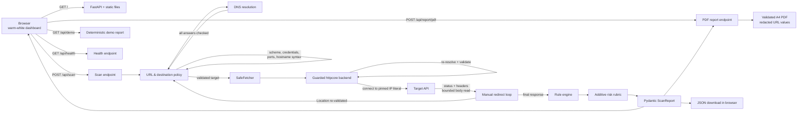
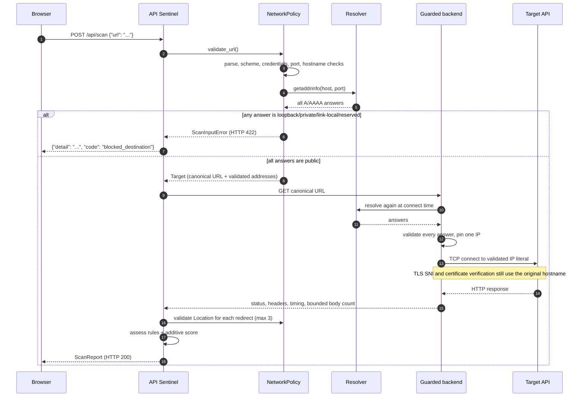

# API Sentinel — Architecture

## 1. Scope

API Sentinel is a local, single-process web application that performs a **bounded,
non-destructive HTTP assessment** of one public API endpoint. It answers four questions:

1. Did the endpoint return an HTTP response, and what was the status?
2. How long did the final response take?
3. Which of a small, explicit set of security-related response headers are present?
4. What do those observations imply for configuration hygiene, with what evidence and
   remediation advice?

It does **not** authenticate, fuzz, exploit, enumerate routes, test business logic, or
attempt denial of service.

---

## 2. Component diagram



---

## 3. Runtime components

| File | Responsibility |
| --- | --- |
| `main.py` | FastAPI application, dependency wiring, security headers, static dashboard, API endpoints |
| `app/config.py` | Environment-backed policy settings and hard limits |
| `app/url_safety.py` | URL parsing, hostname rules, DNS resolution, IPv4/IPv6 address policy |
| `app/network.py` | Guarded transport, DNS-pinned connection backend, bounded fetch, redirect handling, safe error mapping |
| `app/scanner.py` | Header rules, risk calculation, report construction and limitations |
| `app/pdf_report.py` | Validated ReportLab PDF renderer, text escaping, collection limits, URL redaction |
| `app/demo.py` | Deterministic sample report (no network) |
| `app/models.py` | Pydantic request/response models |
| `demo_target.py` | Intentionally under-configured local HTTP API for demonstrations |
| `static/` | HTML, CSS, vanilla JavaScript dashboard |
| `tests/` | Deterministic pytest suite with mocked and local HTTP responses |

---

## 4. Scan sequence



An unreachable target is **not** an input error. Once URL validation succeeds, a timeout or
connection failure is returned as a structured `ScanReport` with `reachable: false`, an
`error.code`, and an availability finding. Invalid or prohibited destinations return
HTTP 422.

---

## 5. SSRF and network safety design

### 5.1 Allowed input

- Schemes: `http`, `https` only.
- Ports: explicit allow-list, default `80, 443, 8000, 8001, 8080, 8443`.
- Length: at most 2048 characters.
- Hostnames are IDNA-normalised and label-validated.
- Embedded credentials (`user:pass@`) are rejected.
- Backslashes, whitespace, control characters, IPv6 zone identifiers, and
  percent-encoded hostnames are rejected.
- Local/internal suffixes such as `.local`, `.internal`, `.home.arpa`, `.lan`,
  `.intranet`, and `.corp` are rejected before DNS.

### 5.2 Address policy

By default, every resolved address must be globally routable. The following are blocked:

- IPv4/IPv6 loopback, private, link-local, multicast, reserved, unspecified ranges.
- Documentation ranges (`192.0.2.0/24`, `198.51.100.0/24`, `2001:db8::/32`).
- Shared address space (`100.64.0.0/10`).
- IPv4-mapped IPv6 addresses are unwrapped and rechecked.
- Transition ranges that can embed IPv4 destinations are blocked:
  NAT64 `64:ff9b::/96`, 6to4 `2002::/16`, Teredo `2001::/32`.
- If **any** answer for a hostname is not permitted, the entire hostname is rejected
  (no "safest answer" selection from a split-horizon response).

Loopback is permitted only when `API_SENTINEL_ALLOW_LOOPBACK=1` (local demo). Even then,
RFC1918, link-local, and other non-public ranges remain blocked.

### 5.3 DNS rebinding / TOCTOU

A check that resolves DNS and then hands the hostname to a separate HTTP client is
vulnerable to DNS rebinding. API Sentinel therefore does the authoritative check inside
the socket-connect path:

1. `GuardedAsyncTransport` installs a custom `httpcore.AsyncNetworkBackend`.
2. On each TCP connect, the backend resolves the hostname.
3. It validates **all** returned addresses.
4. It connects to one validated **IP literal**.
5. The hostname is not resolved again for that connection. TLS SNI and certificate
   verification still use the original hostname because httpcore performs TLS around the
   returned stream.

`tests/test_network.py::test_dns_rebinding_to_private_address_is_blocked_at_connect_time`
uses a resolver that returns a public address on the first call and loopback on the second.
The connection layer blocks the second answer.

### 5.4 Redirects

- Automatic redirect following is disabled.
- `301`, `302`, `303`, `307`, and `308` are followed manually, up to 3 hops.
- Every `Location` is resolved relative to the current URL, then passed through the full
  URL, DNS, port, and address policy again.
- A redirect to a blocked destination is **not** followed. The report retains the 3xx
  response and adds a `redirect.blocked` finding.
- The number of redirects is bounded; the time budget covers the whole scan, not only the
  first request.

### 5.5 Resource limits

| Control | Default |
| --- | --- |
| Total scan wall-clock timeout | 8 s |
| DNS timeout | 4 s |
| Maximum redirects | 3 |
| Response body read | 64 KiB, then close |
| Maximum DNS answers | 16 |
| Outbound connections per scan | 4 (initial + redirects) |
| HTTP version | HTTP/1.1 only |
| Proxy environment | Ignored (`trust_env=False`) |
| Unix sockets | Disabled |

### 5.6 Safe errors

Client-facing messages are authored by the application. Exception reprs and resolved
addresses are not returned. Unexpected exceptions are logged server-side and replaced with
a generic internal-error message. The application never reflects target HTML or body
content into the dashboard; all report values are inserted with `textContent`.

### 5.7 Residual risks

No application-level SSRF filter is a substitute for network egress controls. For a
production deployment:

- Run the scanner in a dedicated network namespace or container with a deny-by-default
  egress policy.
- Permit only ports 80/443 to the public internet.
- Block access to the cloud metadata endpoint at the network layer.
- Keep `API_SENTINEL_ALLOW_LOOPBACK` unset.
- Add authentication and per-user rate limiting before exposing the scanner to anyone.
- Monitor DNS and connection logs.

DNS CNAME chains are resolved by the system resolver into final addresses, which are then
validated; however, a compromised resolver or local OS resolver behaviour remains in the
trusted computing base.

---

## 6. Rule engine

### 6.1 Checks

| ID | Observation | Severity | Notes |
| --- | --- | --- | --- |
| `transport.plaintext_http` | Final URL is HTTP | High | HTTPS is the primary transport control |
| `headers.hsts_missing` | HTTPS response lacks HSTS | Medium | Not applicable over HTTP |
| `headers.hsts_disabled` | `max-age=0` | Medium | Explicitly disables HSTS |
| `headers.hsts_short_max_age` | `max-age < 180 days` | Low | Short protection window |
| `headers.hsts_no_max_age` | HSTS present without usable `max-age` | Low | Directive ineffective |
| `headers.x_content_type_options_missing` | No `X-Content-Type-Options` | Low | `nosniff` recommended |
| `headers.x_content_type_options_invalid` | Value is not `nosniff` | Low | |
| `headers.csp_missing` | No CSP | Medium | Relevance is higher for browser-facing routes |
| `headers.csp_unsafe_directives` | CSP contains `unsafe-inline`/`unsafe-eval` | Low | |
| `headers.referrer_policy_missing` | No `Referrer-Policy` | Low | |
| `headers.referrer_policy_unsafe` | `unsafe-url` | Low | |
| `http.non_success_status` | Final status is 4xx | Medium | Reachable ≠ successful |
| `http.non_success_status` | Final status is 5xx | High | |
| `http.unfollowed_redirect` | 3xx without a usable redirect problem | Low | |
| `performance.elevated_latency` | ≥ 1000 ms | Low | Time to final response headers |
| `performance.slow_response` | ≥ 3000 ms | Medium | |
| `redirect.blocked` | Redirect destination rejected | High | Not followed |
| `redirect.too_many` | Redirect limit reached | Medium | |
| `availability.target_unreachable` | Timeout, TLS failure, connection failure | High | Critical if the connect layer blocked a rebinding attempt |

A missing header is reported as a **configuration observation**, not a confirmed
vulnerability.

### 6.2 Score

```text
score = min(100, Σ weight(finding))
weights: critical 40 | high 25 | medium 10 | low 5 | info 0
bands:   0–9 Low | 10–34 Moderate | 35–59 High | 60–100 Critical
```

The score is additive and deliberately simple. It is **not** a validated industry-standard
risk rating. Every finding's weight is included in the JSON report and displayed in the UI.

---

## 7. Report data model

`ScanReport` (Pydantic) contains:

- identity: `report_id`, `scanner_version`, `rule_version`
- target: `target_url`, `final_url`, `scanned_at`
- availability: `reachable`, `http_status`, `http_reason`, `application_ok`,
  `response_time_ms`
- assessment: `risk_score`, `risk_level`, `findings[]`, `checks[]`, `risk_model`
- network provenance: `redirect_chain[]`, `redirect_count`, `redirect_problem`
- limits: `body_bytes_read`, `response_truncated`, `limitations[]`
- failure detail: `error{code,message}`
- provenance flag: `demo`

`application_ok` is true only for 2xx. A 401, 404, or 500 response still sets
`reachable: true`.

---

## 8. PDF report export

The dashboard keeps the completed `ScanReport` in memory. **Download JSON** serializes that
object in the browser. **Download PDF Report** sends the same object to
`POST /api/report/pdf`; no second scan is performed.

The endpoint:

1. Rejects request bodies larger than 512 KiB, checking `Content-Length` and the streamed
   body.
2. Validates the payload with `ScanReport.model_validate_json`. HTML or arbitrary content is
   rejected with `422 invalid_report`.
3. Applies collection limits (100 findings, 100 checks, 50 limitations, 20 redirect entries).
4. Renders a paginated A4 document with ReportLab and returns the PDF bytes. Secrets,
   cookies, authorization headers, and response bodies are never included.

The renderer:

- registers DejaVu Sans when available, with Liberation and built-in Helvetica fallbacks;
- escapes every report string for ReportLab's paragraph markup and limits text length;
- removes URL credentials and fragments and replaces query parameter values with
  `REDACTED`, including URLs embedded in finding text;
- handles zero findings, long text, multiple pages, Unicode, and special characters;
- includes severity counts, check results with explicit PASS/WARN/FAIL/NOT APPLICABLE/
  UNKNOWN labels, methodology, limitations, responsible-use guidance, page numbers, and the
  creator attribution;
- returns `Content-Type: application/pdf`, `Cache-Control: no-store`, and a download filename
  based on the report date.

PDF failures return safe JSON errors and never expose internal exception details. The
endpoint is stateless and has no access to the network client.

## 9. Testing strategy

- **Unit tests** cover URL parsing, scheme/port/credential rejection, IPv4/IPv6 policy,
  split-horizon answers, header rules, scoring, and report structure.
- **API tests** use `httpx.MockTransport` and an injected deterministic resolver, so no
  external network is required.
- **Integration tests** start a loopback-only `ThreadingHTTPServer` and exercise the real
  guarded transport: redirects, link-local blocking, body caps, timeout, and connection
  refusal.
- **PDF tests** cover MIME type, filename, valid PDF markers, zero and many findings, long
  text across pages, Unicode/special characters, redaction, invalid/oversized payloads, and
  the guarantee that rendering never invokes the network layer.
- **Dashboard tests** check required sections, creator attribution, export controls,
  temporary-history wording, palette tokens, focus styling, and safe DOM usage.
- **Rebinding test** alternates DNS answers to prove the connect-time check is authoritative.
- The suite never depends on a public website being online.

---

## 10. Deployment boundary

The default bind address is `127.0.0.1:8000`. The project is a local MVP, not a hosted
multi-tenant scanning service. If it is ever deployed remotely, it requires at minimum:

- authentication and authorization,
- per-user rate limiting and quotas,
- an outbound egress firewall / isolated network namespace,
- audit logging,
- TLS termination,
- and a formal review of the SSRF policy.
